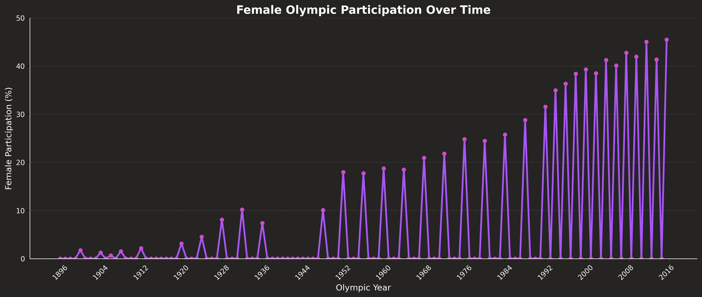
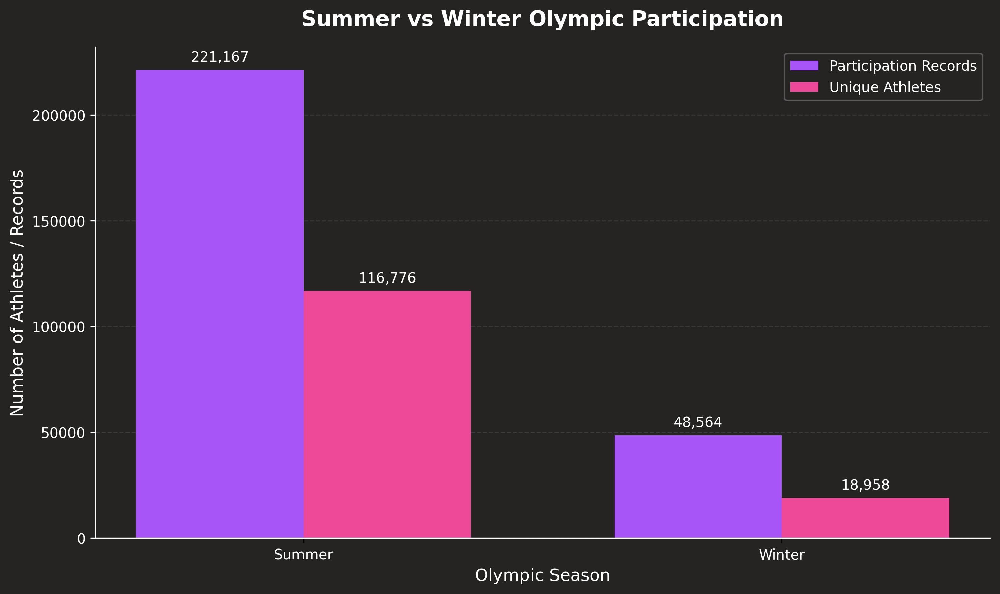
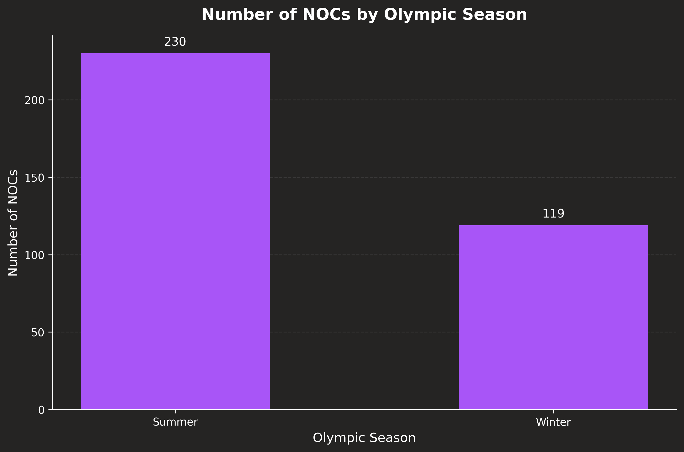
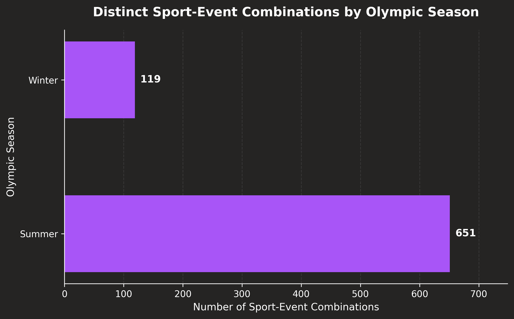
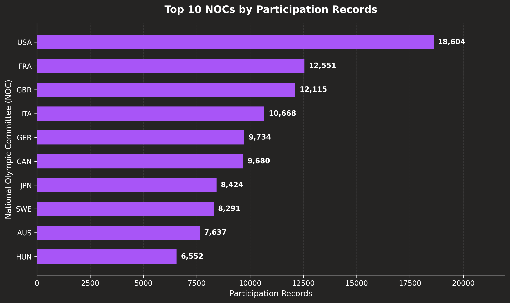
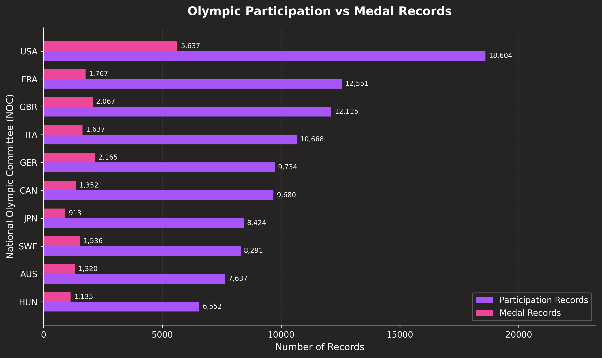
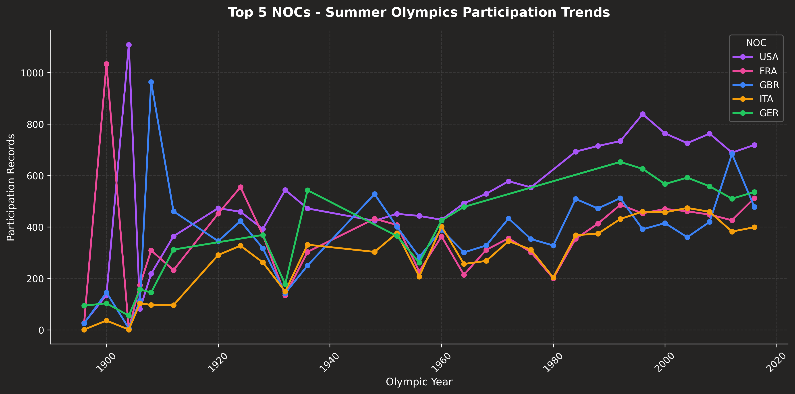
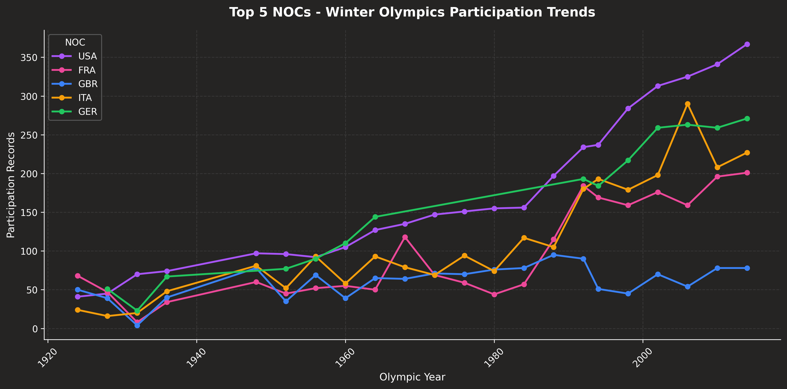
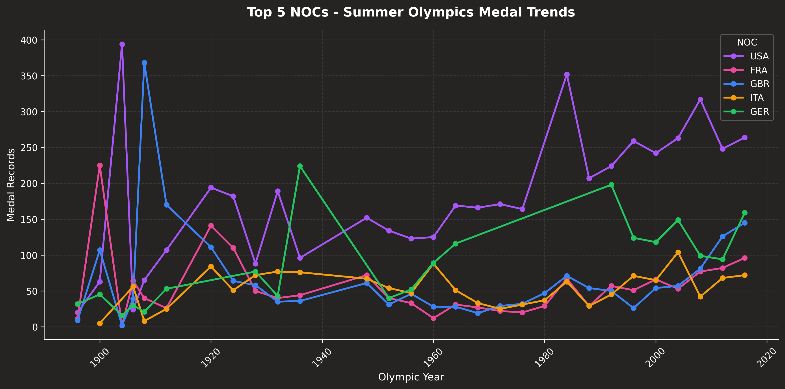
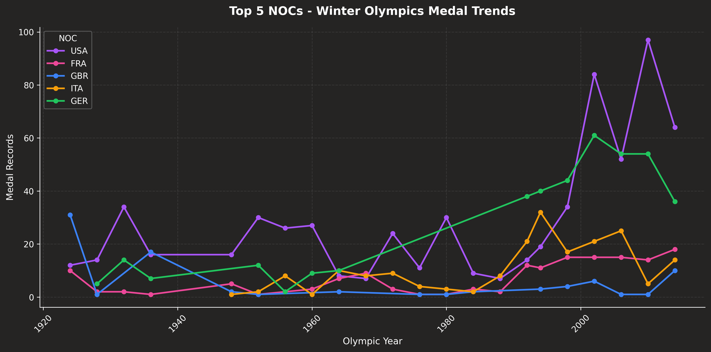

# 120-YEARS-OF-OLYMPIC-HISTORY-PROJECT


Analyzed 120 years of Olympic history using Python, exploring athlete participation, gender representation, summer vs winter Games, and country-level participation and medal trends through data cleaning, EDA, and visualization. Historical data on the modern Olympic Games, from Athens 1896 to Rio 2016. Each row corresponds to an individual athlete competing in an individual event, including the athlete's name, sex, age, height, weight, country, and medal, and the event's name, sport, games, year, and city.


## Table of Content

-	Project Overview
-	Project Objectives
-	Dataset Description
-	Data Cleaning and Processing
-	Exploratory Data Analysis (EDA)
-	Analysis Questions, Python Code and Results
-	Visualizations and Interpretations
-	Key Findings
-	Conclusion
-	 Recommendations
  


##  Project Overview


### Project Description

The 120 Years of Olympic History project involves the exploration and analysis of historical Olympic athlete participation data using Python.
The dataset covers the modern Olympic Games from Athens 1896 to Rio 2016. It contains athlete-level records, including demographic information, National Olympic Committee (NOC), sport, event, Olympic season, year, and medal achievements.
The project focuses on understanding participation patterns, examining differences between the Summer and Winter Olympic Games, and identifying country-level participation and medal trends over time.


### Project Purpose

The purpose of this project is to apply data analytics techniques to a historical Olympic dataset to uncover meaningful patterns and insights about athlete participation, gender representation, and country performance. Python libraries, including Pandas and Matplotlib, are used to clean, process, analyze, and visualize the data.


##  Project Objectives

**The main objectives are to:**

-	Examine female athlete participation and visualize how the percentage of female athletes has changed over time.
-	Compare the Summer and Winter Olympic Games based on athlete participation, participating countries (NOCs), and events.
-	Identify the countries (NOCs) with the highest athlete participation records.
-	Compare participation records with medal records to examine whether the most represented NOCs also achieve the highest medal counts.
-	Analyze and visualize historical country-level participation and medal trends.

   
### Scope of the Project

The analysis covers Olympic athlete participation records from 1896 to 2016, including both Summer and Winter Olympic Games.
The project includes data inspection, data cleaning, missing-value treatment, exploratory data analysis, statistical calculations, and data visualization.
The analysis is limited to the information available in the supplied dataset. Country-level comparisons use National Olympic Committee (NOC) codes, which may represent historical Olympic delegations rather than today's sovereign countries.


## Dataset Description, Dictionary and Structure

The dataset used for this project is titled 120 Years of Olympic History. It contains historical records of athletes who participated in the modern Olympic Games from Athens 1896 to Rio 2016. Each row represents an athlete's participation in a particular Olympic event. An athlete may therefore appear in multiple rows if they participated in several events or Olympic editions. The dataset contains demographic information about athletes, their National Olympic Committee (NOC), the Olympic Games they participated in, their sports and events, and their medal achievements.

**Dataset Structure: The original dataset contained 271,116 rows and 15 columns.**

After data inspection, duplicate removal, missing-value treatment, and the creation of an additional classification column, the cleaned dataset contained 269,731 rows and 16 columns.


| Dataset Information | Details |
|---|---:|
| Original Rows | 271,116 |
| Original Columns | 15 |
| Cleaned Rows | 269,731 |
| Cleaned Columns | 16 |
| Unique Athletes | 135,571 |
| Olympic Games Editions | 51 |
| Sports | 66 |
| Events (Distinct Event Values) | 765 |
| National Olympic Committee Codes | 230 |


**Data Dictionary**

**The dataset contains the following columns:**

| Column | Description |
|---|---|
| ID | Unique identification number assigned to each athlete. |
| Name | Full name of the athlete. |
| Sex | Gender of the athlete (M = Male, F = Female). |
| Age | Age of the athlete at the time of the Olympic event. |
| Height | Athlete's height measured in centimetres. |
| Weight | Athlete's weight measured in kilograms. |
| Team | Name of the team or delegation represented by the athlete. |
| NOC | Three-letter National Olympic Committee code representing the Olympic delegation. |
| Games | Olympic edition, identified by year and season. |
| Year | Year in which the Olympic Games took place. |
| Season | Olympic season (Summer or Winter). |
| City | Host city of the Olympic Games. |
| Sport | Sport in which the athlete participated. |
| Event | Specific event in which the athlete competed. |
| Medal | Medal awarded to the athlete (Gold, Silver, Bronze, or missing if no medal was recorded). |
| Medal_Status | Additional column created during data cleaning to classify records as Gold, Silver, Bronze, or No Medal. |


### Important Dataset Considerations

-	The ID column identifies individual athletes, but an athlete can have multiple participation records.
-	Repeated athlete IDs do not automatically indicate duplicate records.
-	NOC represents National Olympic Committee codes. These codes may reflect historical Olympic delegations and should not always be interpreted as modern country names.
-	Missing values in the Medal column indicate that no medal was recorded for that participation. These values were retained and classified using the Medal_Status column.
-	Medal records in this project represent athlete-event records with medals, not necessarily the number of distinct physical medals awarded.
  

## Data Cleaning and Processing

Data cleaning was performed using Python in Google Colab, with the Pandas library.

The objective was to ensure that the dataset was consistent, reliable, and suitable for exploratory data analysis.

###  Importing the Required Libraries

**The following Python libraries were imported:**


```python
import pandas as pd
import numpy as np
import matplotlib.pyplot as plt
```


### Purpose of the Libraries

| Library | Purpose |
|---|---|
| Pandas | Data loading, manipulation, cleaning, and analysis. |
| NumPy | Numerical operations and handling missing values. |
| Matplotlib | Creating charts and visualizations. |


### Loading and Inspecting the Dataset

The original dataset was loaded into Google Colab and stored in a Pandas DataFrame.

**The following inspection methods were used:**

```python
Data.head()
Data.shape
Data.info()
Data.describe()
```

 **Inspection results:**

-	Original dataset size: 271,116 rows and 15 columns.
-	The dataset contained 10 object columns, 3 float columns, and 2 integer columns.
-	The Age, Height, Weight, and Medal columns contained missing values.
-	The remaining columns had no missing values at the initial inspection stage.
  
The head() method was used to preview the first five records, while shape, info(), and describe() helped examine the dataset structure and numerical distributions.


###  Identifying and Removing Duplicate Records

**Duplicate records were investigated using:**


```python
Data.duplicated().sum()
```

The initial inspection identified 1,385 duplicate rows. These were exact duplicate records, meaning the same complete record appeared more than once.

**To remove them, the following code was used:**

```python
Data = Data.drop_duplicates()
```

**The dataset was checked again:**

```python
Data.duplicated().sum()
```

**Important decision:**

Repeated athlete IDs were not removed because they represent athletes who participated in multiple events or Olympic editions. The cleaning process targeted exact duplicate rows rather than repeated athlete identities.


### Checking Missing Values

**Missing values were investigated using:**


```python
Data.isnull().sum()
```

**The following missing values were identified after duplicate removal:**

**Result:** 0 duplicate rows remained.

After removing duplicates, the dataset contained 269,731 rows.


| Column | Missing Values |
|---|---:|
| Age | 9,315 |
| Height | 58,814 |
| Weight | 61,527 |
| Medal | 229,959 |
| Other Columns | 0 |

**The percentage of missing values was also calculated:**


```python
Data.isnull().sum() / len(df)) * 100
```


**Results:**

| Column | Missing Percentage |
|---|---:|
| Age | 3.45% |
| Height | 21.80% |
| Weight | 22.81% |
| Medal | 85.25% |


 **Observation:**

-	Age had a relatively small percentage of missing values.
-	Height and Weight had higher percentages of missing values.
-	Medal had the highest percentage of missing values because most athlete participation records did not result in a medal.

  
### Investigating Age Outliers

The Age column was examined to identify unusually high values.

**The descriptive statistics showed:**

-	**Minimum age:** 10
-	**Median age:** 24
-	**Maximum age:** 97
  
The Interquartile Range (IQR) method was used to investigate potential outliers. The calculated upper boundary was 38.5 years. Values above this boundary were flagged for further investigation, rather than automatically deleting these records, athletes aged 80 and above were examined. Seven historical records were identified, including athletes involved in Art Competitions.


| Athlete | Age | Olympic Year |
|---|---:|---:|
| John Quincy Adams Ward | 97 | 1928 |
| Winslow Homer | 96 | 1932 |
| Thomas Cowperthwait Eakins | 88 | 1932 |
| George Denholm Armour | 84 | 1948 |
| Robert Tait McKenzie | 81 | 1948 |
| Louis Tauzin | 81 | 1924 |
| Max Liebermann | 80 | 1928 |


 **Cleaning decision:**

The high-age records were retained because the investigation did not establish that they were incorrect. Their presence was associated with historical Art Competitions rather than necessarily representing data-entry errors. This prevented the unnecessary removal of potentially valid historical records.


###  Handling Missing Values in Age, Height, and Weight

After investigating the missing values and examining the numerical distributions, median imputation was selected to fill the missing numerical values. The median was preferred because it is less affected by extreme values than the mean.

- **Age**
  
The overall median age was calculated as 24 years.

**Missing Age values were filled using:**


```python
Data["Age"] = Data["Age"].fillna(Data["Age"].median())
```

- **Height**
  
Height was filled using the median grouped by Sex and Sport. This approach helped account for differences in typical height across athlete groups. Where the group median was unavailable, the overall Height median of 175 cm was used as a fallback.

- **Weight**
  
Weight was also filled using the median grouped by Sex and Sport. Where the group median was unavailable, the overall Weight median of 70 kg was used as a fallback.

**The following approach was used for both Height and Weight:**

```python
Data["Height"] = Data["Height"].fillna(
    Data.groupby(["Sex", "Sport"])["Height"].transform("median")
)
```

```python
Data["Height"] = Data["Height"].fillna(175.0)
```

```python
Data["Weight"] = Data["Weight"].fillna(
    Data.groupby(["Sex", "Sport"])["Weight"].transform("median")
)
```

```python
Data["Weight"] = df["Weight"].fillna(70.0)
```


| Column | Missing Values After Cleaning |
|---|---:|
| Age | 0 |
| Height | 0 |
| Weight | 0 |

This ensured that the three numerical columns had no remaining missing values.


### Creating the Medal_Status Column

The original Medal column contained 229,959 missing values.These missing values were retained because they represented athlete participation records without a recorded medal.

To make medal classification easier during analysis, a new column called Medal_Status was created.

```python
Data["Medal_Status"] = Data["Medal"].fillna("No Medal")
```

**The resulting classification was:**


| Medal Status | Number of Records |
|---|---:|
| No Medal | 229,959 |
| Gold | 13,369 |
| Bronze | 13,295 |
| Silver | 13,108 |
| **Total** | **269,731** |


**Cleaning decision:**

The original Medal column was preserved, while the new Medal_Status column was added to distinguish medal-winning records from participation records without medals.
This made it easier to analyze medal achievements without incorrectly treating missing medal values as data errors.


After completing the cleaning process, the cleaned dataset was stored in a new DataFrame:

```python
Data_clean = Data.copy()
```

The final dataset was checked to confirm its structure and quality.


**Final Data Validation Results:**

| Validation | Result |
|---|---:|
| Total Rows | 269,731 |
| Total Columns | 16 |
| Unique Athletes | 135,571 |
| Remaining Exact Duplicate Rows | 0 |
| Missing Age Values | 0 |
| Missing Height Values | 0 |
| Missing Weight Values | 0 |
| Missing Medal Values | 229,959 |
| Missing Medal_Status Values | 0 |

Note: The 229,959 missing Medal values were intentionally retained because they represent athletes who did not win a medal.


### Data Cleaning Summary

The cleaning process improved the dataset by removing exact duplicate records, addressing missing numerical values, investigating unusual age values, and introducing a new medal classification column.

The final cleaned dataset contained 269,731 rows and 16 columns, with no remaining exact duplicate rows and no missing values in the numerical columns used for analysis.
The dataset was therefore prepared for Exploratory Data Analysis (EDA).


##  Exploratory Data Analysis (EDA)

Exploratory Data Analysis (EDA) was performed to understand the structure of the cleaned dataset, identify important patterns, and generate insights before drawing conclusions.
The analysis was conducted using Pandas for calculations and Matplotlib for data visualization.


### High-Level Key Performance Indicators (KPIs)

The first stage of the analysis focused on extracting key metrics that provide an overview of Olympic participation and achievements across the dataset.

**The following KPIs were calculated:**


 **Total Participation Records**
  
```python
total_participation_records = len(Data_clean)
print("Total Participation Records:", total_participation_records)
```

 **Unique Athletes**

```python
unique_athletes = Data_clean["ID"].nunique()
print("Unique Athletes:", unique_athletes)
```

 **Olympic Games Editions**

```python
olympic_games_editions = Data_clean["Games"].nunique()
print("Olympic Games Editions:", olympic_games_editions)
```

**Number of Sports**

```python
number_of_sports = Data_clean["Sport"].nunique()
print("Number of Sports:", number_of_sports)
```

**Number of Events**

```python
number_of_events = Data_clean["Event"].nunique()
print("Number of Events:", number_of_events)
```

**National Olympic Committee Codes**

```python
number_of_nocs = Data_clean["NOC"].nunique()
print("National Olympic Committee Codes:", number_of_nocs)
```

**Total Medal Records**

```python
total_medal_records = Data_clean["Medal"].notna().sum()
print("Total Medal Records:", total_medal_records)
```

### Key Performance Indicators (KPIs)

| KPI | Result |
|---|---:|
| Total Participation Records | 269,731 |
| Unique Athletes | 135,571 |
| Olympic Games Editions | 51 |
| Number of Sports | 66 |
| Number of Events (Distinct Event Values) | 765 |
| National Olympic Committee Codes | 230 |
| Total Medal Records | 39,772 |


**Key Observations:**

-	The cleaned dataset contains 269,731 athlete-event participation records.
-	These records represent 135,571 unique athletes, showing that many athletes participated in multiple events or Olympic editions.
-	The dataset covers 51 Olympic Games editions across the Summer and Winter seasons.
-	A total of 66 sports and 765 distinct Event values were identified.
-	The dataset contains 230 distinct NOC codes across its historical coverage.
-	There are 39,772 athlete-event records with an awarded medal.
  
  
**Interpretation:**

These KPIs provide an overview of the scale and coverage of the dataset. They establish a foundation for examining gender representation, seasonal differences, and country-level participation and medal trends.


## Analysis Questions, Python Code, Results, Visualizations and Interpretations

### Analysis Question 1: Analyze and visualize the % of athletes who were female over time.

**Gender Participation Analysis**

The objective of this analysis was to understand gender representation in the Olympic Games and examine how female athlete participation has evolved over time. The cleaned dataset was grouped by the Sex column to calculate the number of male and female participation records.

**Python Code:**

```python
gender_participation = Data_clean["Sex"].value_counts()
gender_percentage = (
    gender_participation / len(Data_clean) * 100
)
gender_summary = pd.DataFrame({
    "Gender": gender_participation.index.map({
        "M": "Male",
        "F": "Female"
    }),
    "Participation Records": gender_participation.values,
    "Percentage": gender_percentage.values
})
gender_summary.loc[len(gender_summary)] = [
    "Total",
    gender_participation.sum(),
    100.00
]
gender_summary["Percentage"] = gender_summary["Percentage"].map(
    lambda x: f"{x:.2f}%"
)

gender_summary
```

**Results:**


| Gender | Participation Records | Percentage |
|---|---:|---:|
| Male | 195,353 | 72.43% |
| Female | 74,378 | 27.57% |
| **Total** | **269,731** | **100%** |


 **Interpretation:**

Male athletes accounted for approximately 72.43% of all participation records, while female athletes accounted for 27.57%.
This indicates that male participation was considerably higher across the historical Olympic records covered by the dataset.

 **Female Participation Over Time**

The next analysis examined how the percentage of female participation changed across Olympic years.
The percentage was calculated by dividing the number of female participation records in each year by the total participation records for that year, then multiplying by 100.

**Python Code:**

```python
Female Participation Percentage = (Female Participation Records / Total Participation Records) × 100
```

**Results:**


| Olympic Year | Female Participation |
|---|---:|
| 1900 | 1.74% |
| 1952 | 17.97% |
| 1996 | 36.34% |
| 2000 | 39.30% |
| 2008 | 42.76% |
| 2016 | 45.46% |

 **Key Findings:**

-	Female participation was very low in the early Olympic editions.
-	In 1900, female athletes accounted for only 1.74% of participation records.
-	By 2016, the percentage had increased to 45.46%.
-	This represents an increase of 43.72 percentage points between 1900 and 2016.
  
**Interpretation:**

The results indicate a substantial increase in female representation in the Olympic Games over time. Although male participation remained higher across the dataset, the growing percentage of female participation reflects a major change in gender representation throughout Olympic history.

 **Visualization**

A line chart was used to illustrate the percentage of female participation across Olympic years.

- **Chart type:** Line Chart
- **Reason for selection:** A line chart is suitable for displaying changes over time and makes it easier to identify the overall direction and pattern of female participation.
  

### Female Olympic Participation Over Time





### Analysis Question 2: Compare and contrast the summer and the winter games

**How many athletes compete?**

**How many countries compete?**

**How many events are there?**


The objective of this analysis was to identify differences between the Summer and Winter Olympic Games in terms of athlete participation, participating National Olympic Committees (NOCs), and the variety of events offered. 

#### How many athletes compete?

The first comparison examined the number of athlete participation records and unique athletes across the two Olympic seasons.


**Python Code:**

```python
season_summary = Data_clean.groupby("Season").agg(
    Participation_Records=("ID", "count"),
    Unique_Athletes=("ID", "nunique")
)
season_summary
```

**Results:**

| Olympic Season | Participation Records | Unique Athletes |
|---|---:|---:|
| Summer | 221,167 | 116,776 |
| Winter | 48,564 | 18,958 |


 **Key Findings:**
 
•	The Summer Olympics recorded 221,167 participation records.
•	The Winter Olympics recorded 48,564 participation records.
•	The Summer Games had approximately 4.55 times as many participation records as the Winter Games.
•	The Summer Games also recorded a higher number of unique athletes.

 **Interpretation:**
 
The Summer Olympics had substantially higher athlete participation than the Winter Olympics throughout the dataset's historical coverage. This difference is reflected in both the total participation records and the number of unique athletes.

**Visualization:**

A bar chart was used to compare the participation records and unique athlete counts between the two Olympic seasons.


### Summer vs Winter Olympic Participation





#### How many countries compete?

Comparison of Participating Countries (NOCs), this analysis examined the number of distinct National Olympic Committee codes represented in the Summer and Winter Olympic Games.

**Python Code:**

```python
season_countries = Data_clean.groupby("Season")["NOC"].nunique()
season_countries = season_countries.reset_index()
season_countries.columns = ["Olympic Season", "Number of NOCs"]
season_countries
```

**Results:**

| Olympic Season | Number of NOCs |
|---|---:|
| Summer | 230 |
| Winter | 119 |


**Key Findings:**

-	The Summer Olympics recorded 230 distinct NOC codes.
-	The Winter Olympics recorded 119 distinct NOC codes.
-	The Summer Games had 111 more distinct NOC codes than the Winter Games.
  

**Interpretation:**

- The Summer Olympics had a wider range of participating NOCs across the historical period covered by the dataset.
- This comparison uses distinct NOC codes across all editions of each season, rather than counting participating NOCs in a single Olympic edition.


**Visualization:**

A bar chart was used to compare the number of distinct NOCs represented in the Summer and Winter Games.


### Number of NOCs by Olympic Season





#### How many events are there?

The final comparison examined the variety of events across the Summer and Winter Olympic Games associated with different sports, the analysis counted distinct Sport-Event combinations within each season.

**Python Code:**

```python
season_events = Data_clean.groupby("Season").apply(
    lambda x: x[["Sport", "Event"]].drop_duplicates().shape[0]
)
season_events = season_events.reset_index()
season_events.columns = [
    "Olympic Season",
    "Distinct Sport-Event Combinations"
]
season_events.loc[len(season_events)] = [
    "Total",
    season_events["Distinct Sport-Event Combinations"].sum()
]
season_events
```

**Results:** 

| Olympic Season | Distinct Sport-Event Combinations |
|---|---:|
| Summer | 651 |
| Winter | 119 |
| **Total** | **770** |

Note: This counts distinct combinations of Sport and Event, rather than distinct Event names alone.


**Key Findings:**

-	The Summer Olympics recorded 651 distinct Sport-Event combinations.
-	The Winter Olympics recorded 119 distinct Sport-Event combinations.
-	The Summer Games had a wider variety of Sport-Event combinations across the dataset.
  
**Interpretation:**

- The Summer Olympics covered a considerably wider range of Sport-Event combinations than the Winter Olympics during the period examined.
- It is important to note that these figures represent distinct combinations across all historical editions, not the number of events held in one particular Olympic Games edition.

**Visualization:**

A horizontal bar chart was used to compare the number of distinct Sport-Event combinations between the two Olympic seasons.


### Distinct Sport-Event Combinations by Olympic Season





 **Overall Comparison and Findings:**

- The comparison shows that the Summer Olympics had higher athlete participation, a greater number of participating NOCs, and a wider variety of Sport-Event combinations than the Winter Olympics.
- These differences demonstrate the larger participation scale and broader event coverage of the Summer Games across the historical period represented in the dataset.


### Analysis Question 3: Analyze and visualize country-level trends

**Which countries send the most athletes to the olympics?**

**Do they also tend to win the most medals?**

**How have these trends changed over time?**


The objective of this analysis was to identify the National Olympic Committees (NOCs) with the highest athlete participation records, examine whether they also recorded the highest medal achievements, and investigate how their participation and medal records changed over time.

#### Which countries send the most athletes to the olympics?

The first analysis identified the ten NOCs with the highest number of athlete participation records across the dataset.

**Python Code:**

```python
top_10_nocs = (
    df_clean["NOC"]
    .value_counts()
    .head(10)
    .reset_index()
)
top_10_nocs.columns = ["NOC", "Participation Records"]
top_10_nocs.insert(
    0,
    "Rank",
    range(1, len(top_10_nocs) + 1)
)
top_10_nocs
```

**Results:**

| Rank | NOC | Participation Records |
|---:|:---:|---:|
| 1 | USA | 18,604 |
| 2 | FRA | 12,551 |
| 3 | GBR | 12,115 |
| 4 | ITA | 10,668 |
| 5 | GER | 9,734 |
| 6 | CAN | 9,680 |
| 7 | JPN | 8,424 |
| 8 | SWE | 8,291 |
| 9 | AUS | 7,637 |
| 10 | HUN | 6,552 |


**Key Findings:**

-	The USA recorded the highest participation with 18,604 records.
-	France ranked second with 12,551 records.
-	Great Britain ranked third with 12,115 records.
-	Germany and Canada ranked fifth and sixth, respectively, with only 54 records separating them.
-	Hungary completed the top ten with 6,552 participation records.
  
**Interpretation:**

The results show that the USA had the highest athlete participation across the Olympic history covered by the dataset. Several European NOCs also featured prominently among the ten highest participating NOCs.

**Visualization:**

A descending horizontal bar chart was used to display the top ten NOCs by participation records.

### Top 10 NOCs by Participation Records





#### Do they also tend to win the most medals?

This analysis examined whether the NOCs with the highest participation records also recorded the highest number of medals. The medal comparison was restricted to the same top ten NOCs identified in the participation analysis.

**Python Code:**

```python
noc_summary = Data_clean.groupby("NOC").agg(
    Participation_Records=("ID", "count"),
    Medal_Records=("Medal", lambda x: x.notna().sum())
)
top_10_noc_summary = (
    noc_summary
    .nlargest(10, "Participation_Records")
    .reset_index()
)
top_10_noc_summary
```

**Results:**

| NOC | Participation Records | Medal Records |
|:---:|---:|---:|
| USA | 18,604 | 5,637 |
| FRA | 12,551 | 1,767 |
| GBR | 12,115 | 2,067 |
| ITA | 10,668 | 1,637 |
| GER | 9,734 | 2,165 |
| CAN | 9,680 | 1,352 |
| JPN | 8,424 | 913 |
| SWE | 8,291 | 1,536 |
| AUS | 7,637 | 1,320 |
| HUN | 6,552 | 1,135 |


**Key Findings:**

-	The USA ranked first in both participation and medal records.
-	Germany ranked fifth in participation but second in medal records.
-	Great Britain ranked third in both comparisons.
-	France ranked second in participation but fourth in medal records.
-	Japan ranked seventh in participation but tenth in medal records.
-	Sweden ranked eighth in participation but seventh in medal records.
  
**Interpretation:**

- The comparison indicates a general relationship between higher athlete participation and higher medal records. However, the rankings are not identical.
- Some NOCs recorded more medals relative to their participation rankings, while others had high participation but lower medal rankings.
- This suggests that a higher number of participation records does not automatically translate into the highest medal achievement.


 **Visualization:**

A clustered horizontal bar chart was created to compare participation records and medal records across the ten NOCs.


### Olympic_Participation_vs_Medals





**Data consideration:** Medal records represent athlete-event records associated with medals, not necessarily distinct physical medals or unique medal-winning athletes. Team events may generate multiple athlete medal records for a single event medal.


#### How have these trends changed over time?

This analysis examined how athlete participation changed over time for the five leading NOCs by overall participation.

**The selected NOCs were:**

-	USA — United States
-	FRA — France
-	GBR — Great Britain
-	ITA — Italy
-	GER — Germany

Participation records were grouped by Year, Season, and NOC to examine historical changes separately for the Summer and Winter Olympic Games.

**Python Code:**

```python
top_5_nocs = (
    Data_clean["NOC"]
    .value_counts()
    .head(5)
    .index
)
top_5_participation = Data_clean[
    Data_clean["NOC"].isin(top_5_nocs)
]
participation_trends = (
    top_5_participation
    .groupby(["Year", "Season", "NOC"])
    .size()
    .reset_index(name="Participation_Records")
)
participation_trends
```


**Results:**

| Year | Season | NOC | Participation Records |
|---:|:---:|:---:|---:|
| 1896 | Summer | FRA | 26 |
| 1896 | Summer | GBR | 25 |
| 1896 | Summer | GER | 94 |
| 1896 | Summer | ITA | 1 |
| 1896 | Summer | USA | 27 |
| ... | ... | ... | ... |
| 2016 | Summer | FRA | 512 |
| 2016 | Summer | GBR | 478 |
| 2016 | Summer | GER | 536 |
| 2016 | Summer | ITA | 399 |
| 2016 | Summer | USA | 719 |

**Total Rows:** 237  
**Total Columns:** 4


**Key Findings:**

-	The analysis produced 237 grouped records across the selected NOCs.
-	Participation patterns were examined across different Olympic editions.
-	In the 2016 Summer Olympics, the USA recorded the highest participation among the selected NOCs with 719 records.
-	Germany followed with 536 records, France with 512, Great Britain with 478, and Italy with 399.

  
**Interpretation:**

- The historical analysis provides a view of how participation among the leading NOCs changed across Olympic editions.
- Separating the Summer and Winter Games makes the comparison more meaningful because both seasons may have Olympic editions in the same calendar year.

**Visualizations:**

Two line charts were created to examine participation trends separately:

-	Summer Olympics participation trends.
-	Winter Olympics participation trends.
   
### Summer Top 5 NOCs Participation Trends





### Winter Top 5 NOCs Participation Trends





#### How have these trends changed over time?

This analysis examined how medal records changed over time for the same five NOCs. The analysis included only records where a medal was awarded. Medal records were grouped by Year, Season, and NOC.

**Python Code:**

```python
top_5_nocs = (
    Data_clean["NOC"]
    .value_counts()
    .head(5)
    .index
)
top_5_medals = Data_clean[
    (Data_clean["NOC"].isin(top_5_nocs)) &
    (Data_clean["Medal"].notna())
]
medal_trends = (
    top_5_medals
    .groupby(["Year", "Season", "NOC"])
    .size()
    .reset_index(name="Medal_Records")
)
medal_trends
```

**Results:**

| Year | Season | NOC | Medal Records |
|---:|:---:|:---:|---:|
| 1896 | Summer | FRA | 11 |
| 1896 | Summer | GBR | 9 |
| 1896 | Summer | GER | 32 |
| 1896 | Summer | USA | 20 |
| 1900 | Summer | FRA | 225 |
| ... | ... | ... | ... |
| 2016 | Summer | FRA | 96 |
| 2016 | Summer | GBR | 145 |
| 2016 | Summer | GER | 159 |
| 2016 | Summer | ITA | 72 |
| 2016 | Summer | USA | 264 |

**Total Rows:** 223  
**Total Columns:** 4


**Key Findings:**

-	The analysis produced 223 grouped records.
-	In the 1896 Summer Olympics, Germany recorded 32 medal records, followed by the USA with 20, France with 11, and Great Britain with 9.
-	In the 2016 Summer Olympics, the USA recorded the highest medal records among the five NOCs with 264.
-	Germany followed with 159, Great Britain with 145, France with 96, and Italy with 72.
  
**Interpretation:**

- The results demonstrate changes in medal records among the leading participating NOCs across Olympic history.
- Germany led the selected group in medal records in the 1896 Summer Olympics, while the USA led the group in 2016.
- This illustrates that medal performance rankings among leading NOCs have changed over time.

**Visualizations:**

Two line charts were created to display medal trends separately for the Summer and Winter Olympic Games.

-	summer_top_5_noc_medal_trends.png
-	winter_top_5_noc_medal_trends.png


### Summer Top 5 NOCs Medal Trends





### Winter Top 5 NOCs Medal Trends





##  Key Findings 

The analysis of the 120 Years of Olympic History dataset produced the following major findings:

**1. Female Participation Increased Over Time**

-	Male athletes accounted for 72.43% of total participation records, while female athletes accounted for 27.57%.
-	Female participation increased from 1.74% in 1900 to 45.46% in 2016.
-	This represents an increase of 43.72 percentage points.
-	The findings indicate substantial growth in female representation throughout Olympic history.
  
**2. Summer Olympics Had Higher Participation Than Winter Olympics**

-	Summer Olympics recorded 221,167 participation records, compared with 48,564 for Winter Olympics.
-	Summer Olympics had 116,776 unique athletes, while Winter Olympics had 18,958.
-	The Summer Games recorded 230 distinct NOC codes, compared with 119 for Winter Games.
-	Summer Olympics also recorded 651 distinct Sport-Event combinations, compared with 119 for Winter Olympics.
  
**3. The USA Had the Highest Overall Athlete Participation**

-	The USA ranked first among the top ten NOCs, with 18,604 participation records.
-	France and Great Britain ranked second and third, respectively.
-	Several European NOCs also appeared among the top ten participating NOCs.
  
**4. Higher Participation Did Not Always Mean a Higher Medal Ranking**

-	The USA ranked first in both participation and medal records.
-	Germany ranked fifth in participation but second in medal records.
-	France ranked second in participation but fourth in medal records.
-	These differences show that participation rankings and medal rankings were not always identical.
  
**5. Country Participation and Medal Records Changed Over Time**

-	Historical line charts showed changes in participation and medal records among the five selected NOCs: USA, France, Great Britain, Italy, and Germany.
-	Germany recorded the highest medal records among these five NOCs in the 1896 Summer Olympics, while the USA led in 2016.
-	The results demonstrate changes in the relative participation and medal positions of leading NOCs across Olympic history.


  
## Conclusion

- The analysis of the 120 Years of Olympic History dataset provided valuable insights into historical Olympic participation, gender representation, seasonal differences, and country-level performance.
- The findings show that female participation increased substantially over the years, reflecting a major change in gender representation at the Olympic Games.
- The comparison between the Summer and Winter Olympics revealed that the Summer Games had considerably higher athlete participation, more participating NOCs, and a wider variety of Sport-Event combinations across the dataset's historical coverage.
- At the country level, the USA emerged as the leading NOC in overall participation and medal records among the top ten participating NOCs. However, the comparison also showed that higher participation did not always correspond to a higher medal ranking.
- Finally, the historical trend analysis demonstrated that participation and medal records among leading NOCs changed across Olympic editions.


## Recommendations

**Based on the findings of the analysis, the following recommendations are proposed:**

-	Continue promoting female participation: The growth in female representation highlights the importance of maintaining initiatives that encourage equal opportunities for men and women in sports.
-	Monitor participation across Olympic seasons: Future analyses should continue examining differences between Summer and Winter Games to understand changes in athlete participation and international representation.
-	Evaluate country performance beyond participation: NOCs should consider both participation levels and medal achievements when assessing Olympic performance.
-	Investigate historical changes in national performance: Further analysis can examine the factors behind changes in participation and medal records across different Olympic editions.
-	Improve historical sports data documentation: Maintaining consistent records of athletes, events, NOC codes, and medal achievements will support more reliable historical comparisons.
   


